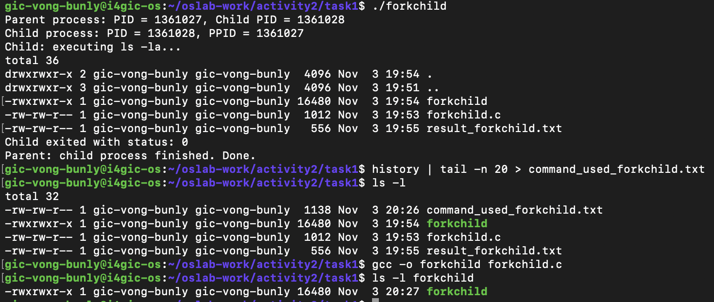
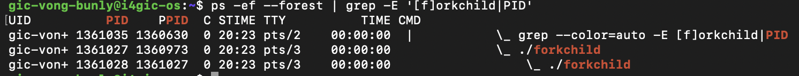
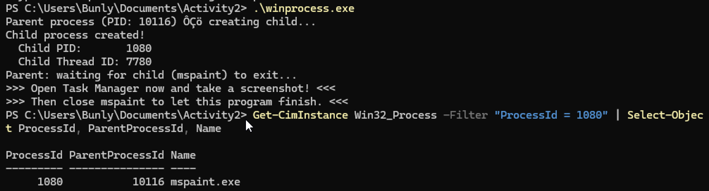
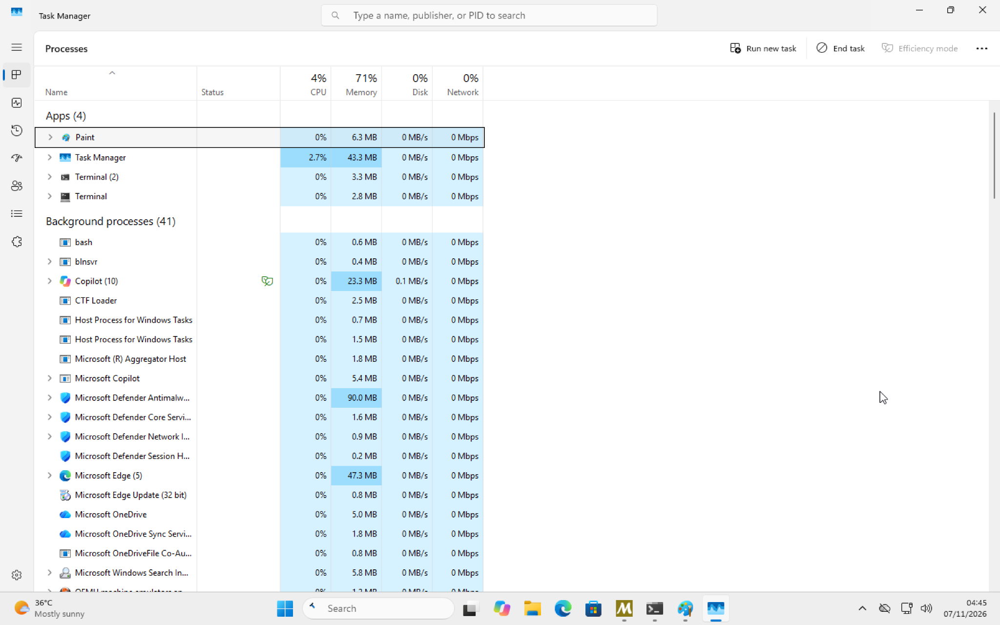
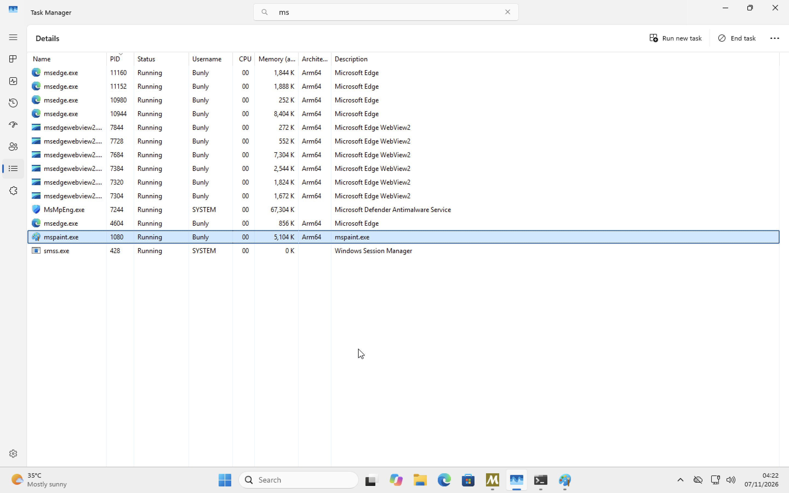
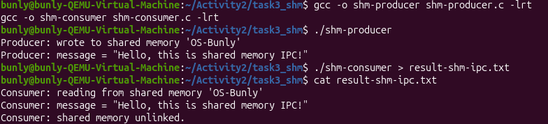
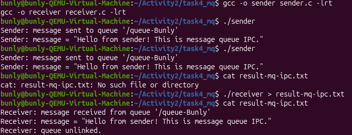

# Class Activity 2 — Processes & Inter-Process Communication

- **Student Name:** Vong Bunly
- **Student ID:** e20231050
- **Date:** November 7, 2026

---

## Task 1: Process Creation on Linux (fork + exec)

### Compilation & Execution

Screenshot of compiling and running `forkchild.c`:



### Process Tree

Screenshot of the parent-child process tree:



### Output

```text
Child process: PID = 1360206, PPID = 1360205
Child: executing ls -la...
total 36
drwxrwxr-x 2 gic-vong-bunly gic-vong-bunly  4096 Nov  3 19:54 .
drwxrwxr-x 3 gic-vong-bunly gic-vong-bunly  4096 Nov  3 19:51 ..
-rwxrwxr-x 1 gic-vong-bunly gic-vong-bunly 16480 Nov  3 19:54 forkchild
-rw-rw-r-- 1 gic-vong-bunly gic-vong-bunly  1012 Nov  3 19:53 forkchild.c
-rw-rw-r-- 1 gic-vong-bunly gic-vong-bunly    72 Nov  3 19:55 result_forkchild.txt
Parent process: PID = 1360205, Child PID = 1360206
Child exited with status: 0
Parent: child process finished. Done.
```

### Questions

1. **What does `fork()` return to the parent? What does it return to the child?**

   > `fork()` returns the child's PID (a positive number) to the parent process. It returns `0` to the child process. If it fails, it returns `-1` to the parent.

2. **What happens if you remove the `waitpid()` call? Why might the output look different?**

   > Without `waitpid()`, the parent does not wait for the child to finish. Both processes run independently, so their output may appear in a different order. If the child finishes before the parent collects its exit status, it may temporarily become a zombie process.

3. **What does `execlp()` do? Why don't we see "execlp failed" when it succeeds?**

   > `execlp()` replaces the current process image with a new program. In this task, the child executes the `ls -la` command. When `execlp()` succeeds, it does not return because the old program has been replaced. The failure message only appears if the function fails.

4. **Draw the process tree for your program (parent → child). Include PIDs from your output.**

   > ```text
   > Parent Process (PID: 1360205)
   >          |
   >          └── Child Process (PID: 1360206)
   >                   |
   >                   └── Executes: ls -la
   > ```

5. **Which command did you use to view the process tree (`ps --forest`, `pstree`, or `htop`)? What information does each column show?**

   > I used the process tree view with `ps --forest` to observe the parent-child relationship. The PID column shows the process ID, PPID shows the parent process ID, and CMD shows the command used to run the process. The tree structure makes it easier to identify which process created another process.

---

## Task 2: Process Creation on Windows

### Compilation & Execution

Screenshot of compiling and running `winprocess.c`:



### Task Manager Screenshots

Screenshot showing the process tree in the **Processes** tab:



Screenshot showing PID and Parent PID in the **Details** tab:



### Questions

1. **What is the key difference between how Linux creates a process (`fork` + `exec`) and how Windows does it (`CreateProcess`)?**

   > Linux commonly uses two steps: `fork()` creates a child process, and `exec()` replaces the child's program with another program. Windows uses `CreateProcess()` to create a new process and load the specified program in one operation. Therefore, Windows combines process creation and program loading in a single API call.

2. **What does `WaitForSingleObject()` do? What is its Linux equivalent?**

   > `WaitForSingleObject()` makes the parent process wait until a specified object, such as a child process, reaches a signaled state. In this task, the parent waits until Paint closes. The Linux equivalent for waiting for a child process to finish is `waitpid()`.

3. **Why do we need to call `CloseHandle()` at the end? What happens if we don't?**

   > `CloseHandle()` releases the handles to the child process and its thread after they are no longer needed. If we do not close them, Windows keeps those handles open, wasting system resources. Repeatedly leaving handles open can cause resource leaks.

4. **In Task Manager, what was the PID of your parent program and the PID of mspaint? Do they match your program's output?**

   > The parent program PID was **10116**, and the Paint process PID was **1080**. These values matched the information printed by my program and verified in PowerShell. The ParentProcessId of Paint was also 10116.

5. **Compare the Processes tab (tree view) and the Details tab (PID/PPID columns). Which view makes it easier to understand the parent-child relationship? Why?**

   > The Processes tab makes it easier to understand the parent-child relationship because it displays processes in a visual hierarchy, with child processes nested under their parent. The Details tab provides more precise information, such as PID and Parent PID, which is useful for checking process identifiers.

---

## Task 3: Shared Memory IPC

### Compilation & Execution

Screenshot of compiling and running `shm-producer` and `shm-consumer`:



### Output

```text
Consumer: reading from shared memory 'OS-Bunly'
Consumer: message = "Hello, this is shared memory IPC!"
Consumer: shared memory unlinked.
```

### Questions

1. **What does `shm_open()` do? How is it different from `open()`?**

   > `shm_open()` creates or opens a POSIX shared memory object that processes can use to share data. Unlike the regular `open()` function, which opens files in a filesystem, `shm_open()` specifically accesses shared memory objects identified by a name.

2. **What does `mmap()` do? Why is shared memory faster than other IPC methods?**

   > `mmap()` maps the shared memory object into a process's virtual address space so the process can access it like normal memory. Shared memory is often faster than other IPC methods because processes can access the same memory region directly without repeatedly copying messages between processes.

3. **Why must the shared memory name match between producer and consumer?**

   > Both processes must use the same shared memory name to access the same shared memory object. If they use different names, the consumer cannot access the memory created by the producer.

4. **What does `shm_unlink()` do? What would happen if the consumer didn't call it?**

   > `shm_unlink()` removes the shared memory object's name from the system. If the consumer does not call it, the shared memory object may remain available even after the processes finish. This can waste system resources until it is properly removed.

5. **If the consumer runs before the producer, what happens? Try it and describe the error.**

   > When the consumer runs before the producer creates the shared memory object, it cannot find the object and fails to open it. The error displayed was:
   >
   > ```text
   > shm_open: No such file or directory
   > Hint: Did you run shm-producer first?
   > ```

---

## Task 4: Message Queue IPC

### Compilation & Execution

Screenshot of compiling and running `sender` and `receiver`:



### Output

```text
Receiver: message received from queue '/queue-Bunly'
Receiver: message = "Hello from sender! This is message queue IPC."
Receiver: queue unlinked.
```

### Questions

1. **How is a message queue different from shared memory? When would you use one over the other?**

   > A message queue allows processes to communicate by sending and receiving messages through a queue managed by the operating system. Shared memory allows processes to access the same memory region directly. I would use a message queue when I want structured messages and simpler communication. I would use shared memory when processes need to exchange large amounts of data quickly.

2. **Why does the queue name in `common.h` need to start with `/`?**

   > POSIX message queue names must start with a forward slash (`/`) and cannot contain additional slashes. This is the naming convention required by the POSIX message queue API. In my program, the queue name is `/queue-Bunly`.

3. **What does `mq_unlink()` do? What happens if neither the sender nor receiver calls it?**

   > `mq_unlink()` removes the message queue's name from the system. If neither process calls it, the queue can remain after the programs finish, potentially leaving unused messages and consuming system resources.

4. **What happens if you run the receiver before the sender?**

   > If the receiver runs before the sender creates the message queue, it cannot open the queue and displays an error:
   >
   > ```text
   > mq_open: No such file or directory
   > Hint: Did you run sender first?
   > ```

5. **Can multiple senders send to the same queue? Can multiple receivers read from the same queue?**

   > Yes. Multiple senders can send messages to the same message queue, and multiple receivers can receive messages from it. The operating system manages access to the queue. However, each message is received by one receiver, not automatically copied to every receiver.

---

## Reflection

> Through this activity, I learned how processes are created and how different processes communicate with each other in operating systems. I practiced using `fork()` and `exec()` on Linux and `CreateProcess()` on Windows. I also learned how shared memory and message queues allow processes to exchange information.
>
> The most interesting difference to me was how Linux and Windows create processes. Linux commonly uses `fork()` to create a child process and `exec()` to replace its program, while Windows uses `CreateProcess()` to create a process and load a program in one operation.
>
> I prefer message queues because they provide a simple and organized way for processes to exchange messages. The operating system manages the queue, so processes do not need to manage a shared memory region directly. Although shared memory can be faster for large amounts of data, message queues are easier for me to understand and use for basic communication.
