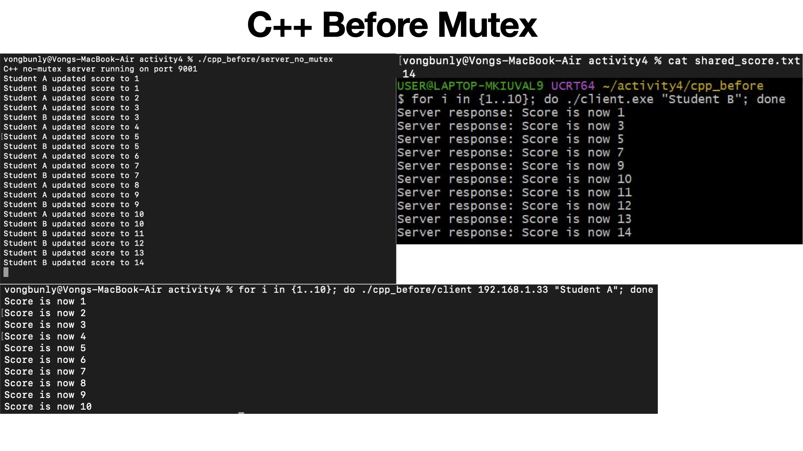
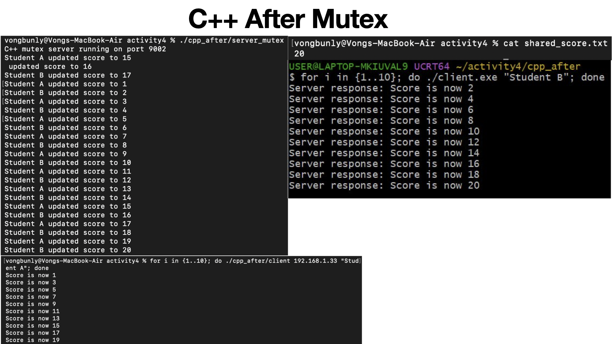
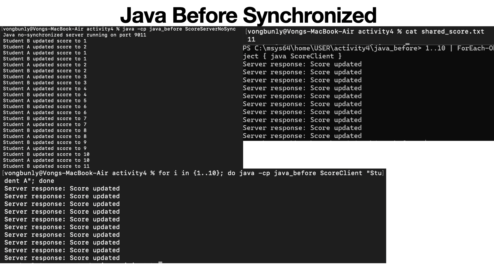
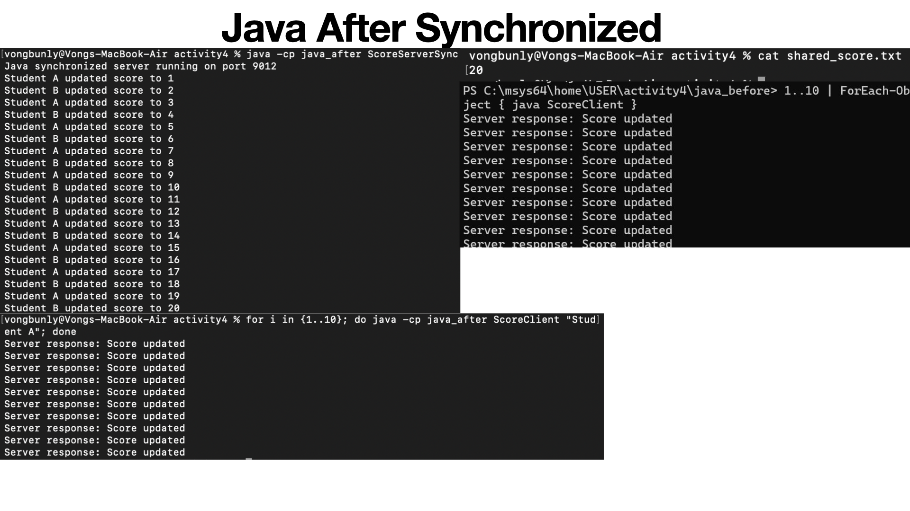

# Class Activity 4 — Shared File API: C++ Mutex & Java synchronized

- **Student Name:** VONG Bunly
- **Student ID:** e20231050
- **Partner Name:** N/A — Completed individually
- **Partner Student ID:** N/A
- **Server Machine Owner:** Myself
- **Server Machine:** MacBook Air
- **Client Machine:** Lenovo Windows laptop
- **Server IP Address:** 192.168.1.33

## Environment and Setup

This activity was completed independently using two physical machines connected to the same Wi-Fi network.

- **MacBook Air:** Hosted the C++ and Java servers and ran Student A clients.
- **Lenovo Windows laptop:** Ran Student B clients.
- Both machines communicated through the local network using the server IP address `192.168.1.33`.

---

## Task 1: C++ Before Mutex

- **Expected score after 20 total client requests:** 20
- **Actual score:** 14
- **What happened:**

Both Student A and Student B sent 10 requests to the C++ server. The server handled each request using a separate thread without protecting the shared file.

The final score was 14 instead of 20 because multiple threads sometimes read the same previous score and overwrote each other's updates. This demonstrated a race condition and lost updates.

---

## Task 2: C++ After Mutex

- **Expected score after 20 total client requests:** 20
- **Actual score:** 20
- **What changed after adding mutex:**

I added `std::mutex` and `std::lock_guard<std::mutex>` to the `update_score()` function.

The lock protects the complete file update operation, including reading the current score, incrementing it, and writing the new value.

Only one thread can execute this critical section at a time. As a result, all 20 requests were processed correctly, and the final score was 20.

---

## Task 3: Java Before synchronized

- **Expected score after 20 total client requests:** 20
- **Actual score:** 11
- **What happened:**

Both Student A and Student B sent 10 requests to the Java server. The server created separate threads to handle client requests, but the `updateScore()` method was not synchronized.

Multiple threads accessed and modified the shared file at the same time. Some updates were overwritten, resulting in a final score of 11 instead of 20.

This demonstrated a race condition in the Java implementation.

---

## Task 4: Java After synchronized

- **Expected score after 20 total client requests:** 20
- **Actual score:** 20
- **What changed after adding synchronized:**

I declared the `updateScore()` method as `static synchronized`.

This ensures that only one thread at a time can execute the synchronized method on the server class. Other threads must wait until the current thread finishes updating the shared file.

The final score was 20, showing that all 20 requests were successfully counted.

---

## Questions

### 1. Why should clients send requests to the server instead of writing the file directly?

Clients should send requests to the server because the server acts as a central point for managing the shared file. If every client writes directly to the file, multiple clients may access and modify it simultaneously, causing race conditions and data inconsistency.

By using a server, file operations can be controlled in one place, and synchronization can be applied to protect the shared resource.

### 2. Why does the server still have a race condition before mutex or synchronized?

Even though clients communicate through one server, the server can create multiple threads to handle requests simultaneously.

If two threads read the same score before either writes an updated value, both may calculate the same next score. When they write to the file, one update can overwrite the other.

Therefore, a server also needs synchronization when multiple threads access shared data.

### 3. In the C++ fixed version, what does `std::lock_guard<std::mutex>` protect?

`std::lock_guard<std::mutex>` protects the critical section inside the `update_score()` function.

It locks the mutex when the lock guard is created and automatically unlocks it when the lock guard goes out of scope.

It ensures that only one thread at a time can perform the file read, increment, and write operations.

### 4. In the Java fixed version, what does `synchronized` protect?

The `synchronized` keyword protects the `updateScore()` method.

Because it is a static synchronized method, Java uses the class-level monitor. Only one thread at a time can execute this method for the same class.

This prevents multiple threads from modifying the shared score simultaneously.

### 5. Why is the final score expected to be 20 when Student A sends 10 requests and Student B sends 10 requests?

The initial score is 0. Student A sends 10 requests, and Student B sends another 10 requests.

Each request should increase the score by one.

Therefore:

10 + 10 = 20

The expected final score is 20, provided that no updates are lost.

### 6. What could happen if two separate servers update the same file at the same time?

If two separate servers update the same file simultaneously, they may both read the same old score and calculate the same next value.

Their writes can overwrite each other, causing lost updates and an incorrect final score.

A mutex in one server does not automatically protect the file from another independent server process. A synchronization mechanism shared across processes, such as file locking or a database transaction, would be needed.

---

## Reflection

This activity helped me understand how race conditions can happen when multiple threads access a shared resource.

In C++, `std::mutex` and `std::lock_guard` provide a way to protect a critical section. In Java, the `synchronized` keyword provides a similar mechanism by allowing only one thread at a time to execute a synchronized method using the same monitor.

Both approaches prevent concurrent updates from overwriting each other.

From the experiments, the unsynchronized C++ and Java servers produced final scores of 14 and 11, while their synchronized versions both produced the correct score of 20.

This demonstrated that using a server alone is not enough to guarantee safe file access. The server must also protect shared resources when handling concurrent requests.
